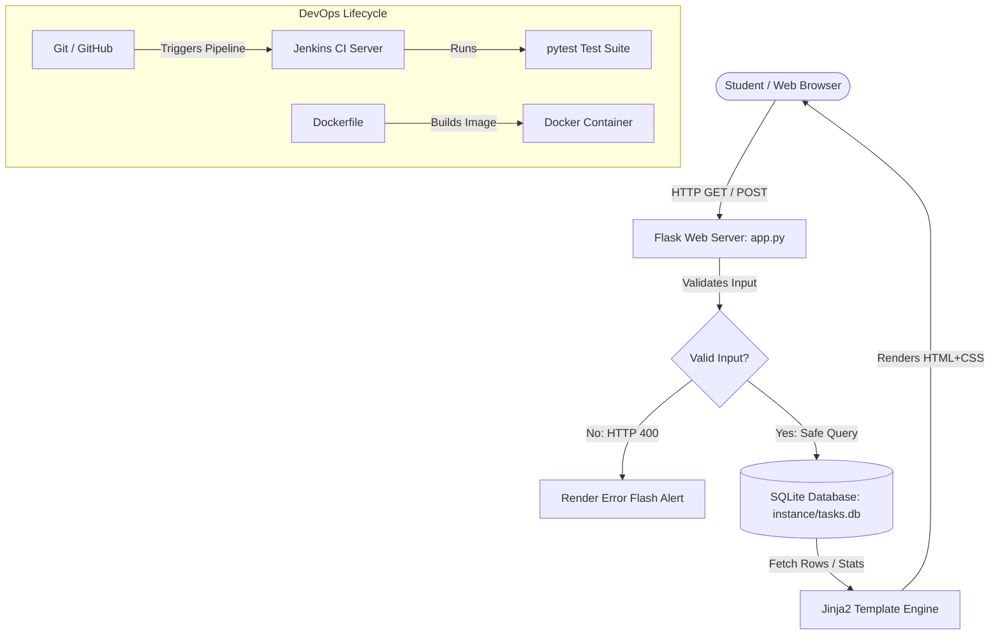

# Viva & Practical Examination Preparation Guide
## Project: Student Task Management System (STMS)

This guide is specially prepared for your practical examination and viva voce. It covers core concepts, architecture diagrams, technical decisions, file walkthroughs, common errors, and 25 essential viva questions with clear, simple answers.

---

## 1. Project Abstract

The **Student Task Management System** is a lightweight, responsive web application developed using **Python, Flask, and SQLite**. The system is tailored for university students to record, prioritize, categorize, track, and manage academic coursework, laboratory assignments, and project deliverables. It features real-time progress metrics (Total, Pending, In Progress, Completed), server-side input validation, multi-criteria filtering, and secure parameterized database interactions. For modern software engineering compliance, the project integrates **Git & GitHub** for version control, **Jira** for agile sprint planning, **pytest** for automated testing, **Docker** for containerization, and a **Jenkinsfile** for continuous integration (CI).

---

## 2. Problem Statement and Objectives

### **Problem Statement**
Students in higher education frequently balance multiple coursework assignments, lab reports, seminar presentations, and project milestones simultaneously across various subjects. Relying on disorganized notes or mental reminders leads to missed deadlines, elevated stress, and poor academic scheduling.

### **Objectives**
1. **Centralized Academic Planner:** Provide a single dashboard to capture, view, and organize academic tasks.
2. **Dynamic Workload Analytics:** Summarize active vs. completed workloads in real-time.
3. **Data Integrity & Persistence:** Store tasks reliably in a local SQLite relational database that persists across restarts.
4. **Agile & DevOps Demonstration:** Showcase practical implementation of modern software engineering methodologies (Testing, Git, Docker, CI, and Agile tracking).

---

## 3. Hardware and Software Specifications

### **Hardware Requirements**
- **Processor:** Intel Core i3 / AMD Ryzen 3 or higher
- **RAM:** 4 GB minimum (8 GB – 16 GB recommended)
- **Disk Space:** 500 MB free storage
- **Operating System:** Windows 10/11, macOS, or Linux

### **Software Requirements**
- **Programming Language:** Python 3.10+ (tested on Python 3.14)
- **Web Framework:** Flask 3.x (with Werkzeug & Jinja2)
- **Database:** SQLite 3 (built into Python standard library)
- **Testing Framework:** pytest 8.x / 9.x
- **Container Engine:** Docker Engine / Docker Desktop
- **CI Tool:** Jenkins Automation Server
- **Version Control:** Git 2.x & GitHub
- **Project Tracking:** Atlassian Jira

---

## 4. System Architecture & Workflow



### **Step-by-Step Workflow:**
1. **User Request:** The student accesses `http://127.0.0.1:5000/`.
2. **Route Handling:** Flask's `@app.route('/')` triggers the `index()` function.
3. **Database Query:** Safe SQL executes against `instance/tasks.db` to calculate status counts and fetch tasks.
4. **Jinja2 Rendering:** Data is merged into `index.html` and returned as pure HTML/CSS to the browser.
5. **Task Mutation (Create/Edit/Delete):** Form data is submitted via POST. Flask validates inputs on the server, modifies the SQLite database, flashes a notification, and redirects back to the dashboard.

---

## 5. Database Design & Explanation

The application uses an embedded **SQLite relational database** stored locally at `instance/tasks.db`.

### **Database Schema: `tasks` Table**

| Column Name | Data Type | Constraints | Description |
| :--- | :--- | :--- | :--- |
| `id` | `INTEGER` | `PRIMARY KEY AUTOINCREMENT` | Unique identifier for each task |
| `title` | `TEXT` | `NOT NULL` | Name/summary of the assignment (max 150 chars) |
| `description` | `TEXT` | `NULL` | Optional detailed notes, requirements, or steps |
| `priority` | `TEXT` | `NOT NULL DEFAULT 'Medium'` | Priority level: `'Low'`, `'Medium'`, or `'High'` |
| `due_date` | `TEXT` | `NULL` | Deadline date string in ISO format (`YYYY-MM-DD`) |
| `status` | `TEXT` | `NOT NULL DEFAULT 'Pending'` | Workflow state: `'Pending'`, `'In Progress'`, `'Completed'` |
| `created_at` | `TIMESTAMP` | `DEFAULT CURRENT_TIMESTAMP` | Automatic timestamp of task creation |

### **Why Parameterized Queries?**
We use SQLite parameter substitution (`?`) instead of f-strings or string concatenation:
```python
# SECURE (Used in our project):
db.execute("SELECT * FROM tasks WHERE status = ?", (status_filter,))

# INSECURE (Vulnerable to SQL Injection):
# db.execute(f"SELECT * FROM tasks WHERE status = '{status_filter}'")
```
*Examiner Explanation:* Parameterized queries treat user input strictly as data, never as executable SQL code, preventing SQL Injection vulnerabilities.

---

## 6. Major Files and Folder Structure

```
asdd mini project/
├── app.py                # Main backend: routes, DB helpers, and business logic
├── requirements.txt      # Python dependencies (Flask, pytest)
├── pytest.ini           # Configuration file for automated testing
├── Dockerfile            # Container build recipe
├── .dockerignore         # Excluded files during Docker build context creation
├── Jenkinsfile           # Declarative CI pipeline definition for Jenkins
├── .gitignore            # Git exclusion rules (virtual environments, cache, local DB)
├── README.md             # Comprehensive project documentation
├── JIRA_PLANNING.md      # Agile Jira setup guide, user stories, and acceptance criteria
├── VIVA_PREPARATION.md   # Complete examination preparation guide (this file)
├── instance/             # Persistent SQLite directory
│   └── .gitkeep          # Ensures git tracks the directory without tracking database files
├── static/
│   └── css/
│       └── style.css     # Responsive design, tokens, cards, badges, and layout
├── templates/
│   ├── base.html         # Master layout template (navbar, flash banners, footer)
│   ├── index.html        # Dashboard view (metric cards, filters, task table)
│   ├── add_task.html     # Task creation form with validation hints
│   └── edit_task.html    # Task editing form
└── tests/
    └── test_app.py       # Automated pytest test cases using temporary databases
```

---

## 7. Core Technical Explanations for Viva

### **A. How Flask Routes Work**
Flask uses Python **decorators** (like `@app.route('/path', methods=['GET', 'POST'])`) to bind a URL endpoint to a Python function. When an incoming HTTP request matches the URL pattern, Flask invokes the associated view function, executes database logic, and returns an HTTP response (such as rendered HTML or a redirect).

### **B. Why SQLite was Selected**
1. **Zero Configuration:** Runs as a serverless library embedded directly inside the Python process.
2. **File-Based Storage:** Stores the entire database in a single portable file (`tasks.db`).
3. **ACID Compliant:** Supports atomic transactions, ensuring data integrity.
4. **Ideal for College Demos:** No need to install and configure separate database servers like MySQL or PostgreSQL.

### **C. Git versus GitHub**
- **Git** is a local **Distributed Version Control System (DVCS)** tool installed on your computer that tracks line-by-line changes across code revisions.
- **GitHub** is a cloud-based **hosting platform and collaboration service** for Git repositories, providing remote storage, pull requests, issue tracking, and CI/CD integrations.

### **D. What Jira Does**
Jira is an **Agile project management tool**. It allows teams to break down a project into epics, user stories, and tasks, estimate effort with story points, organize work into sprints (timeboxed iterations), and visualize progress on Scrum or Kanban boards.

### **E. Docker Image versus Container**
- A **Docker Image** is an immutable, read-only template or snapshot containing application code, system libraries, Python runtime, and dependencies (like a blueprint or class).
- A **Docker Container** is a running, stateful instance of that image (like an object instantiated from a class).

### **F. What Jenkins and CI Mean**
- **Continuous Integration (CI)** is a software engineering practice where developers regularly merge code changes into a central repository, after which automated builds and test suites are automatically triggered.
- **Jenkins** is an open-source automation server that orchestrates CI/CD pipelines via stages (Checkout ➔ Install Dependencies ➔ Run Pytest ➔ Publish Reports).

### **G. What pytest Tests**
Pytest is a Python test framework. In our project, it tests:
1. HTTP route status codes (e.g., 200 OK, 400 Bad Request).
2. Database insertion, modification, and deletion operations.
3. Validation rules (preventing empty titles).
4. Calculation logic for dashboard metrics.
5. Task filtering queries.

---

## 8. Twenty-Five Essential Viva Questions & Answers

#### Q1: What is Flask and why is it called a micro-framework?
**Answer:** Flask is a lightweight Python web framework based on WSGI and Jinja2. It is called a "micro-framework" because it does not enforce specific database tools, form libraries, or rigid project structures; it provides core routing and templating while letting developers add what they need.

#### Q2: What is the difference between GET and POST HTTP methods?
**Answer:** `GET` is used to retrieve data from a server and parameters are visible in the URL query string (idempotent and safe). `POST` is used to send data to the server to create or update resources; the data is transmitted securely in the HTTP request body.

#### Q3: What is the Application Factory pattern (`create_app()`) in Flask?
**Answer:** It is a design pattern where the Flask application instance is constructed inside a function rather than as a global object. This enables creating multiple instances with different configurations (e.g., a test instance with an in-memory database and a production instance).

#### Q4: What is Jinja2 and how does template inheritance work?
**Answer:** Jinja2 is Flask's built-in templating engine. Template inheritance allows child templates (`index.html`) to inherit the skeleton layout from a parent template (`base.html`) using `` and ``, avoiding duplicated HTML code.

#### Q5: How are flash messages implemented in Flask?
**Answer:** Flash messages use client-side signed cookies via Flask's `SECRET_KEY`. When `flash('message', 'category')` is called, it stores the message in the session and renders it once on the next page load via `get_flashed_messages()`.

#### Q6: How do you prevent SQL Injection in SQLite?
**Answer:** By using parameterized queries with question marks (`?`) as placeholders instead of string formatting or concatenation. The database driver automatically escapes special characters and treats the parameter strictly as literal data.

#### Q7: What is the purpose of `instance_relative_config=True`?
**Answer:** It tells Flask that configuration files or database files stored in the `instance/` folder should be resolved relative to the instance path, keeping local databases separate from the core version-controlled source code.

#### Q8: What does `PRIMARY KEY AUTOINCREMENT` do in SQLite?
**Answer:** It ensures that every new record inserted into the table receives a unique, sequentially increasing integer ID that will never be reused, even if previous rows are deleted.

#### Q9: What is the role of `requirements.txt`?
**Answer:** It lists the exact external Python packages and versions needed to run the project. Running `pip install -r requirements.txt` reproduces the exact environment on any machine.

#### Q10: Why do we use `.gitignore`?
**Answer:** `.gitignore` specifies untracked files that Git should intentionally ignore, such as virtual environments (`venv/`), compiled Python bytecode (`__pycache__/`), temporary test caches, and local database files.

#### Q11: What is a Git commit hash?
**Answer:** A SHA-1 or SHA-256 cryptographic hash (e.g., `a1b2c3d`) that uniquely identifies a specific snapshot of changes in the Git history.

#### Q12: How do branches work in Git?
**Answer:** A branch in Git is an independent line of development. The `main` branch contains stable code, while `feature/*` branches allow developers to build new features in isolation without disrupting the main codebase.

#### Q13: What is a Scrum Sprint?
**Answer:** A sprint is a fixed-duration timebox (typically 1 to 2 weeks) during which a development team commits to completing a specific set of backlog items from Jira.

#### Q14: What is a Story Point in Jira?
**Answer:** A story point is a relative unit of measure used in Agile estimation to score the total effort, complexity, and risk involved in completing a user story.

#### Q15: What is Docker and why is it used?
**Answer:** Docker is an open-source containerization platform that bundles an application and all its system dependencies into a lightweight container. It eliminates the "it works on my machine" problem.

#### Q16: Why should we avoid running Docker containers as `root`?
**Answer:** Running as `root` inside a container introduces security risks; if an attacker compromises the containerized process, they might escalate privileges to the host system. Creating an unprivileged user (`appuser`) adheres to the principle of least privilege.

#### Q17: What is a Docker Volume and why is it essential for SQLite?
**Answer:** By default, containers are ephemeral—any data written inside a container is deleted when the container is removed. A Docker Volume or bind mount maps a host folder to the container's `/app/instance` directory, ensuring SQLite database records persist permanently.

#### Q18: What is `.dockerignore`?
**Answer:** It specifies files and directories (like `.git`, `venv`, and `__pycache__`) that should be omitted when sending the build context to the Docker daemon, resulting in faster and smaller image builds.

#### Q19: What is Continuous Integration (CI)?
**Answer:** CI is a software engineering practice where developers frequently commit code to a shared repository, and every commit automatically triggers build verification and automated tests to detect bugs early.

#### Q20: What is a `Jenkinsfile`?
**Answer:** A text file containing the definition of a Jenkins Pipeline formatted using Groovy syntax. Storing the pipeline configuration as code alongside the application allows the CI process to be version-controlled.

#### Q21: What is the difference between Unit Testing and Integration Testing?
**Answer:** Unit tests verify individual functions or isolated components in isolation. Integration tests verify that multiple modules work together correctly (e.g., testing that submitting a form correctly inserts data into the SQLite database and renders the updated template).

#### Q22: Why did we use a temporary database fixture in `test_app.py`?
**Answer:** If tests used the real database (`instance/tasks.db`), running tests would corrupt or delete live student records. Using `tempfile.mkstemp()` provides an isolated database that is deleted immediately after testing.

#### Q23: What does the HTTP status code 400 signify?
**Answer:** `400 Bad Request` indicates that the server cannot process the request due to client error, such as failing input validation (e.g., submitting an empty task title).

#### Q24: What is the difference between client-side and server-side validation?
**Answer:** Client-side validation runs in the browser using HTML5 attributes (`required`, `maxlength`) or JavaScript for instant feedback. Server-side validation runs in Python on the server and is mandatory because malicious users can bypass browser validation.

#### Q25: How does the quick status change work without refreshing a complex form?
**Answer:** Each task row contains a lightweight form with a `<select>` dropdown. When the user changes the option, an inline `onchange="this.form.submit()"` triggers an immediate POST request to `/tasks/<id>/status`.

---

## 9. Two-Minute Practical Demonstration Script

Use this exact script when the external examiner asks you to demonstrate your project:

> **[0:00 - 0:25] Introduction & Architecture**
> *"Good morning, sir/madam. Today I am presenting the Student Task Management System. The application is built using Python and Flask on the backend, with SQLite for local relational storage, and responsive HTML5, CSS3, and Jinja2 templates on the frontend. The project adheres to modern DevOps standards, including automated pytest suites, Git version control, Jira agile user stories, Docker containerization, and a Jenkins CI pipeline."*

> **[0:25 - 0:50] Dashboard & Analytics Demonstration**
> *"Here on the dashboard, we have real-time metric cards displaying Total Tasks, Pending, In Progress, and Completed tasks. Currently, we have 0 tasks. Let's create our first task by clicking '+ Add Task'. I will enter 'Operating Systems Lab 3', choose priority 'High', set a due date, and click 'Save Task'."*

> **[0:50 - 1:15] Validation & Mutation**
> *"Notice the green flash confirmation banner at the top, and our Total and Pending metrics have immediately updated to 1. If I try to add a task with an empty title, our server-side validation rejects it with HTTP 400 and displays an error message. Back on the dashboard, I can update the task status directly using the quick status dropdown to 'In Progress' or 'Completed'—notice how the metric counters adjust in real time."*

> **[1:15 - 1:40] Filtering & Safe Deletion**
> *"When a student has dozens of assignments, they can filter by Status or Priority using the filter toolbar. If I select 'High Priority', only High priority tasks appear. When deleting a task, a JavaScript confirmation safeguard prevents accidental deletion. Once confirmed, the record is removed via a safe parameterized SQLite query."*

> **[1:40 - 2:00] Testing & DevOps Conclusion**
> *"Behind the scenes, we have 8 automated pytest tests that verify route loading, validation, CRUD operations, and metrics calculations using temporary test databases. All tests pass in under 2 seconds. The application is also packaged with a production-conscious Dockerfile with volume persistence and a declarative Jenkinsfile. Thank you, I am ready for questions."*

---

## 10. Common Errors and Troubleshooting

| Error | Root Cause | Solution |
| :--- | :--- | :--- |
| `Address already in use (Port 5000)` | Another process (or previous Flask instance) is using port 5000. | In PowerShell: `Get-Process python \| Stop-Process` or run Flask on port 5001: `app.run(port=5001)`. |
| `sqlite3.OperationalError: database is locked` | Another connection has an open uncommitted write transaction. | Ensure all connections use `with conn:` context managers or `db.commit()` and close properly. |
| `ModuleNotFoundError: No module named 'flask'` | Flask is not installed in the active Python environment. | Run `python -m pip install -r requirements.txt`. |
| `jinja2.exceptions.TemplateNotFound` | Flask cannot find the requested HTML file. | Ensure all template files are placed inside the `templates/` folder directly relative to `app.py`. |
| `400 Bad Request on form submit` | Form data key name does not match `request.form.get('key')`. | Verify `name="title"`, `name="status"`, etc., in HTML matches the Python backend handler. |
| `Docker build failure: no space left` | Docker cache is bloated or WSL2 disk limit reached. | Run `docker system prune -f` in terminal. |
